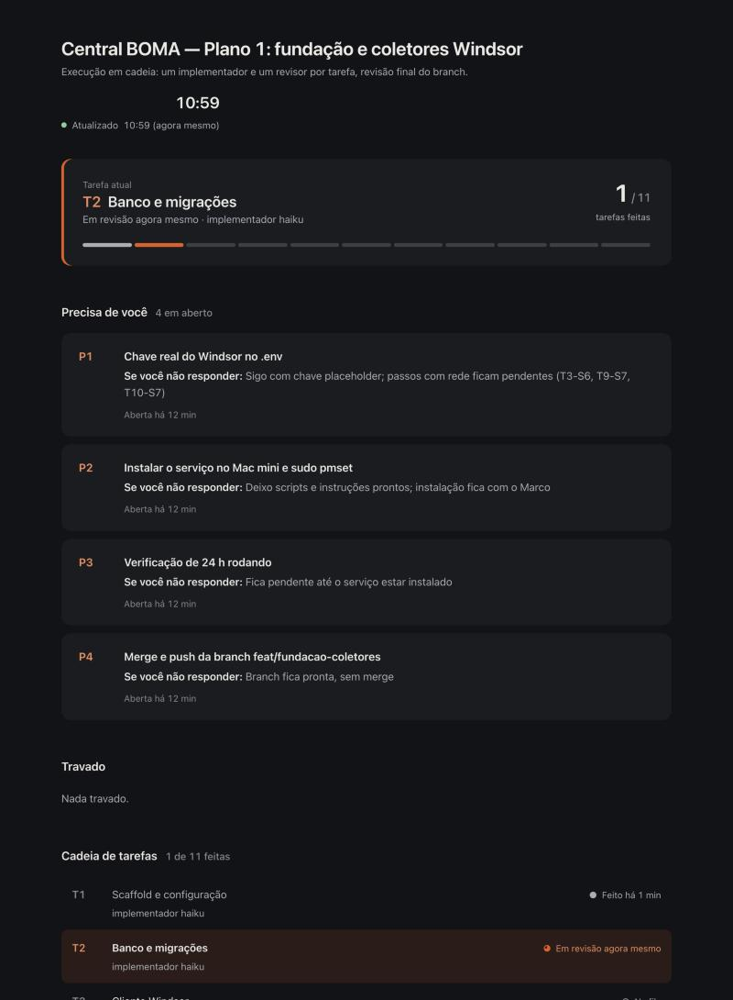

# Painel ao vivo

Quando o Claude Code vai trabalhar por muito tempo, você não precisa ficar olhando o terminal. Ele monta uma página que você abre no navegador e que se atualiza sozinha: em que tarefa ele está, o que está esperando por você, o que já foi entregue e o que travou.



## Em 30 segundos

- **Você não faz nada para ligar.** Antes de uma tarefa com mais de 5 passos ou mais de 30 minutos, o Claude monta o painel e o atualiza a cada passo.
- **Você só abre o arquivo** `.dashboard/index.html` (duplo clique). Ele recarrega a cada 10 segundos.
- **Quando o Claude precisa de uma decisão sua**, ele escreve a pergunta no painel junto com a resposta que vai usar se você não responder, e continua trabalhando. Você volta, vê e corrige se quiser.
- **Na primeira vez**, ele pergunta seu gosto: claro ou escuro, denso ou arejado, uma cor de destaque. Fica salvo e ele não pergunta de novo.

## Instalar (uma vez, uns 2 minutos)

Precisa de Claude Code, `python3` e `node`, em macOS ou Linux. Windows não foi testado.

1. Baixe esta pasta.
2. No Terminal, dentro da pasta:
   ```bash
   ./install.sh --permitir
   ```
3. Se o instalador avisar que falta alguma skill de design, rode os comandos que ele mostrar.
4. **Abra uma sessão nova do Claude Code.** Os agentes só são lidos quando a sessão começa.

O `--permitir` libera o script de atualização nas permissões do Claude Code. Sem ele, o Claude pede sua aprovação a cada atualização do painel. O instalador guarda uma cópia do seu `settings.json` antes de mexer.

Para atualizar, baixe a versão nova da pasta e rode `./install.sh` de novo. Para tirar tudo: `./install.sh --remover`.

## Usar

**No dia a dia:** nada. Peça a tarefa longa normalmente. O Claude avisa o caminho do painel quando ele estiver pronto (leva uns 2 minutos, em segundo plano, e ele já segue trabalhando).

**Para pedir na mão:** "monte um painel ao vivo para isso".

**O que cada bloco mostra:**

| Bloco | O que é |
|---|---|
| Tarefa atual | Onde estamos e quantas tarefas já terminaram |
| Precisa de você | Perguntas em aberto, cada uma com a ação padrão que o Claude vai seguir |
| Travado | O que parou e por quê |
| Cadeia de tarefas | Todas as tarefas com o estado de cada uma |
| Entregas e decisões | O que foi feito e o que o Claude decidiu por você |

O desenho muda de uma tarefa para outra: os blocos são escolhidos para o trabalho do momento.

**Mudar o estilo:** diga "novo estilo: claro, arejado, azul". Ou apague `~/.claude/agent-memory/dashboard-builder/estilo.md` e ele pergunta de novo.

**Onde fica o arquivo:** em `.dashboard/index.html`, na pasta onde o trabalho acontece. A pasta ignora a si mesma no Git (tem um `.gitignore` próprio), então nunca vai para um commit.

## O que ele faz e o que não faz

- O agente que desenha o painel só consegue: ler e escrever em `.dashboard/` e na própria memória, ler as pastas das skills e rodar um único comando (`dashboard-update check`). Um hook bloqueia todo o resto.
- Ele não lê o seu projeto, o `.env` nem suas chaves, e não acessa a internet.
- **Custo:** uma chamada do Opus por tarefa longa, para desenhar. As atualizações do dia a dia não usam modelo: são um script que leva milissegundos.
- Decisão que precisa de você vira pergunta no painel e o trabalho segue com a ação padrão. Ações destrutivas e de segurança continuam parando para perguntar de verdade.

## Problemas comuns

| Sintoma | O que fazer |
|---|---|
| `Agent type 'dashboard-builder' not found` | Abra uma sessão nova. Agentes só carregam no início. |
| O Claude pede aprovação a cada atualização | Rode `./install.sh --permitir`. |
| O painel não muda | Confira se abriu o `.dashboard/index.html` da pasta certa. O painel mostra a hora da última atualização; se ela estiver velha, o Claude parou ou terminou. |
| `ERRO: bloco ... não encontrado` | Peça "monte o painel de novo". |
| O painel apareceu numa pasta inesperada | Ele fica na pasta em que o agente foi chamado. |
| O instalador avisou que falta uma skill | Rode o comando que ele mostrou. Sem as skills o painel sai menos refinado; não testamos o agente sem elas. |

## Para quem mantém

| Arquivo | Vai para | O que é |
|---|---|---|
| `agents/dashboard-builder.md` | `~/.claude/agents/` | O agente (Opus, effort medium, memória do usuário) que desenha o painel |
| `hooks/dashboard-scope.py` | `~/.claude/hooks/` | Limita o agente à pasta `.dashboard/` e à própria memória |
| `bin/dashboard-update` | `~/.claude/bin/` | Atualiza os dados do painel e valida o HTML (`check`). Sem modelo |
| `skills/painel-ao-vivo/SKILL.md` | `~/.claude/skills/` | O procedimento que a sessão principal segue |
| `claude-md.trecho.md` | `~/.claude/CLAUDE.md` | Três linhas que apontam para a skill, entre marcadores |

- Depois de mexer em qualquer arquivo: `./tests/testar.sh` (20 casos do hook e 9 do script, em pasta temporária) e `./install.sh` para copiar.
- O painel é um HTML único com os dados num bloco `<script type="application/json" id="estado">`. Só o `dashboard-update` mexe nesse bloco depois da montagem; o agente só desenha.
- Preferimos este instalador a um plugin por enquanto: o `hooks:` do frontmatter é ignorado em agentes de plugin, então o hook teria que ir para o plugin inteiro, e não dá para garantir sem testar que um agente de plugin enxerga skills instaladas fora dele. Se a equipe crescer, vale migrar.
